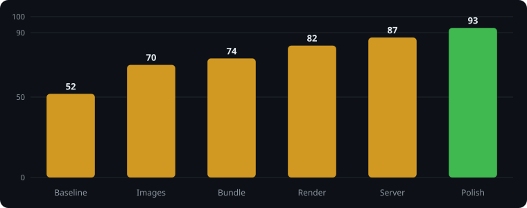
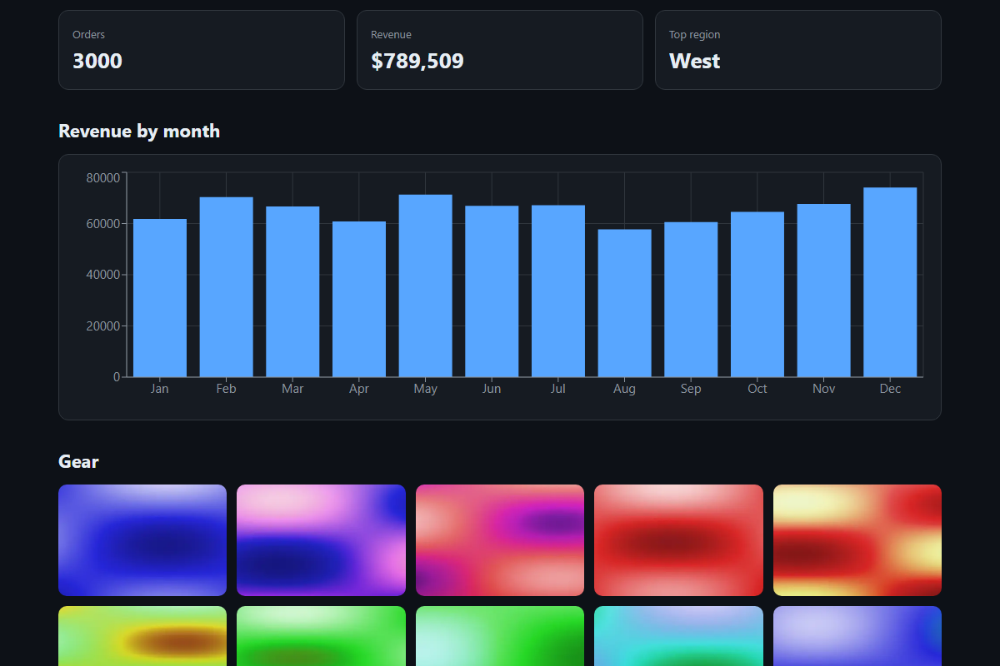

# perf-case-study

A deliberately slow Next.js page, fixed one step at a time, with a Lighthouse measurement after every step. Each stage is a git commit and a tag, so you can diff exactly what changed and what it bought.

**Result: Lighthouse performance 52 → 93. Largest Contentful Paint 8.9 s → 1.7 s. Total blocking time 1,060 ms → 315 ms.**



| Stage | Score | LCP | TBT | CLS | Page weight |
|---|---|---|---|---|---|
| Baseline | 52 | 8.9 s | 1060 ms | 0.03 | 7.5 MB |
| Images | 70 | 2.2 s | 2250 ms | 0.00 | 0.3 MB |
| Bundle | 74 | 2.3 s | 1339 ms | 0.00 | 0.3 MB |
| Render | 82 | 1.6 s | 731 ms | 0.00 | 0.3 MB |
| Server | 87 | 2.1 s | 414 ms | 0.00 | 0.3 MB |
| Polish | 93 | 1.7 s | 315 ms | 0.00 | 0.3 MB |



## The page

A sales dashboard for a made-up outdoor-gear shop: a full-bleed hero photo, summary stats, a revenue chart, a 24-photo gallery and a 3,000-row orders table with a filter. It is built to look ordinary and to be slow in the ways real pages are slow.

## What was wrong, and what fixed it

Each heading is a tag you can check out: `git diff 0-baseline 1-images`.

### Stage 1: Images (`1-images`) &mdash; 52 → 70

- **Problem.** A 3200px hero and 24 gallery photos (1600px each) were plain `` tags: about 7 MB, all loaded eagerly, none sized. The hero was the Largest Contentful Paint element and took 8.9 s on a throttled mobile connection. A banner inserted after load also shifted the layout.
- **Fix.** `next/image` for responsive, modern-format images; `priority` on the hero only; lazy loading and explicit sizes for the gallery; reserved space for the banner.
- **Result.** LCP 8.9 s → 2.2 s, page weight 7.5 MB → 0.3 MB at load, CLS to 0.

Total blocking time went *up* here. With the network no longer the bottleneck, the page's real main-thread work became the critical path. That is why the next stages target JavaScript.

### Stage 2: Bundle (`2-bundle`) &mdash; 70 → 74

- **Problem.** `moment` (with every locale) and all of `lodash` were bundled for a few date formats and a group-by. The chart library loaded up front even though the chart sits below the fold.
- **Fix.** Removed both libraries in favour of `Intl.DateTimeFormat` and plain `Map` code. Loaded the chart with `next/dynamic`.

### Stage 3: Render work (`3-render`) &mdash; 74 → 82

- **Problem.** The page recomputed all its stats on every render, including on every keystroke in the filter, and rendered 1,500 table rows at once.
- **Fix.** `useMemo` for the stats, `useDeferredValue` so typing stays responsive, and a paginated table (50 rows, "Show more").
- **Result.** TBT 1,339 ms → 731 ms.

### Stage 4: Server component (`4-server`) &mdash; 82 → 87

- **Problem.** The whole page was a client component, so the browser downloaded, parsed and ran the code that produces content that never changes between visits, and held all 3,000 orders in memory.
- **Fix.** The page became a server component, rendered at build time. Only the banner, the chart and the filterable table are client components. Filtering and "Show more" call a small `/api/orders` route, so the browser never holds the full data set.
- **Result.** TBT 731 ms → 414 ms. LCP moved up slightly (1.6 s → 2.1 s) within run-to-run noise.

### Stage 5: Polish (`5-polish`) &mdash; 87 → 93

- **Problem.** The chart's JavaScript still loaded on first visit, and the hero was heavier than it needed to be.
- **Fix.** The chart now loads only when it is about to scroll into view (`IntersectionObserver`). Hero quality tuned. Gallery images given `height: auto` so the aspect ratio holds.
- **Result.** TBT 414 ms → 315 ms, LCP back to 1.7 s.

## How it was measured

- Lighthouse 13, mobile preset with its default simulated throttling (slow 4G, 4x CPU slowdown), performance category only.
- Production build served locally with `next start`. Median of 3 runs per stage; raw results are in [`results/`](results/).
- The photos are generated by `scripts/generate-images.mjs` (smooth gradients encoded as full-size JPEGs), so the repo stays small. Real photographs would compress differently, so treat the absolute numbers as indicative and the *relative* improvements as the point.
- "Page weight" is Lighthouse's total transfer size at load. It falls sharply because the gallery now loads lazily.

Lighthouse scores vary by a few points between runs and machines. The ordering of the stages, and the size of each jump, is what this repo is meant to show.

## Run it yourself

```bash
npm install
npm run build        # also generates the images on first run
npm start            # http://localhost:4100
npm run measure -- my-run
```

Set `CHROME_PATH` to a Chrome/Chromium executable if Lighthouse cannot find one. To step through the history:

```bash
git checkout 0-baseline   # the slow version
git checkout 5-polish     # the fast version (or master)
```

## Stack

Next.js 16 (App Router) · React 19 · TypeScript · Lighthouse 13 · sharp
